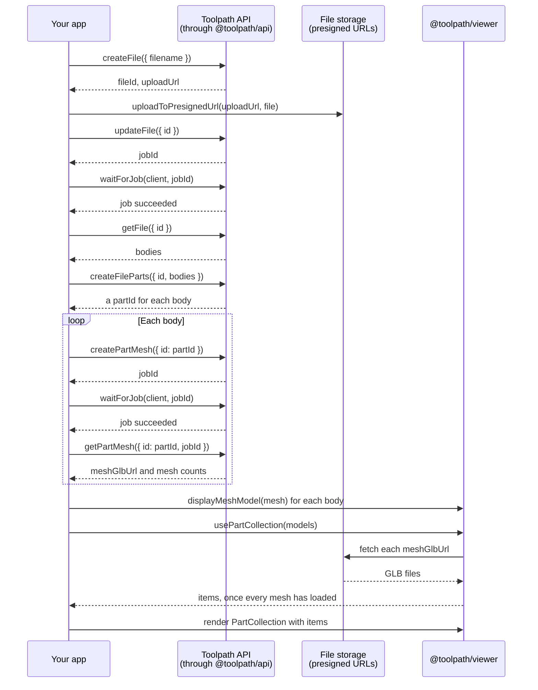

# Multi-body files

The smallest app that uploads a CAD file holding several solid bodies and draws them all with
[`@toolpath/api`](https://www.npmjs.com/package/@toolpath/api) and
[`@toolpath/viewer`](https://www.npmjs.com/package/@toolpath/viewer).

## Run it

```bash
pnpm install --frozen-lockfile
cp multi-body/.env.example multi-body/.env   # then set your API key
pnpm --filter @toolpath/example-multi-body dev
```

Open the URL Vite prints and choose a CAD file. Point at a body in the list to see it alone, or
click it, there or in the scene, to keep it that way. Click its row again to bring the others back.

## Read it

| File                                       | What it does                                                                   |
| ------------------------------------------ | ------------------------------------------------------------------------------ |
| [`src/upload-file.ts`](src/upload-file.ts) | Every API call, in order: file to meshes in four numbered steps.               |
| [`src/main.tsx`](src/main.tsx)             | Meshes to pixels: `displayMeshModel`, `usePartCollection`, `<PartCollection>`. |
| [`vite.config.ts`](vite.config.ts)         | Forwards `/v1` to the API, so any key works from `localhost`.                  |

## How it works

Three words matter here:

- A **file** is the CAD file you upload.
- A **body** is one solid inside that file, named by its `index`.
- A **part** is one body, made into something the API can mesh and analyze.

So the flow is: upload one file, ask what bodies it holds, make a part of each, mesh each part, and
hand all the meshes to the viewer. They draw in place because every mesh keeps the file's
coordinates.



### Upload: file to meshes

In [`src/upload-file.ts`](src/upload-file.ts), with the same step numbers as its comments. The SDK
wraps every call below.

| Step              | SDK call                                                | HTTP request                | What you get back                                                              |
| ----------------- | ------------------------------------------------------- | --------------------------- | ------------------------------------------------------------------------------ |
| 1. Upload         | `files.createFile({ filename })`                        | `POST /v1/files`            | `fileId`, and a short-lived `uploadUrl`                                        |
|                   | `uploadToPresignedUrl(uploadUrl, file)`                 | `PUT` to `uploadUrl`        | Nothing: the bytes go straight to storage, not through the API                 |
| 2. Inspect        | `files.updateFile({ id })`                              | `PATCH /v1/files/{id}`      | A `jobId` for the inspection                                                   |
|                   | `waitForJob(client, jobId)`                             | `GET /v1/jobs/{id}/events`  | The finished job, or a `JobFailedError`                                        |
|                   | `files.getFile({ id })`                                 | `GET /v1/files/{id}`        | `bodies`: each one's `index`, `name` if it has one, `faceCount`, `boundingBox` |
| 3. Make parts     | `files.createFileParts({ id, createFilePartsRequest })` | `POST /v1/files/{id}/parts` | A `partId` for each `bodyIndex`. At most 100 bodies to a call                  |
| 4. Mesh each body | `client.parts.createPartMesh({ id })`                   | `POST /v1/parts/{id}/mesh`  | A `jobId` for the mesh                                                         |
|                   | `waitForJob(client, jobId)`                             | `GET /v1/jobs/{id}/events`  | The finished job, or a `JobFailedError`                                        |
|                   | `client.parts.getPartMesh({ id, jobId })`               | `GET /v1/parts/{id}/mesh`   | `meshGlbUrl`, the mesh counts and `faceTriangleCounts`                         |

`FilesApi` is built by hand at the top of the file, because `createToolpathClient` does not include
it yet.

### Render: meshes to pixels

In [`src/main.tsx`](src/main.tsx), with the same step numbers as its comments. The viewer never
calls the API: it only needs the `getPartMesh` responses.

| Step               | Viewer call                                      | What it does                                                                                                       |
| ------------------ | ------------------------------------------------ | ------------------------------------------------------------------------------------------------------------------ |
| 1. Build models    | `displayMeshModel(mesh)`                         | Turns a `getPartMesh` response into a model, with each face of the body as a region. Keep these objects stable.    |
| 2. Load meshes     | `usePartCollection(models)`                      | Downloads every `meshGlbUrl`. `items` stays `null` until all have loaded, and `failures` and `retry` cover errors. |
| 3. Draw the bodies | `<PartCollection items={items} onPick={onPick}>` | Draws every item in one shared frame. Each item also takes `PartMesh` props, such as `theme` and `visible`.        |

The viewer owns no selection, so the app does:

- `bodyColors` gives each body a colour, used by both `theme` and the list.
- `shown` is the body chosen by a click, and `peek` is the one under the pointer in the list.
- `peek ?? shown` decides which items get `visible: true`. Nothing reloads: the meshes stay loaded
  and only that prop changes.

### Good to know

- **Cost.** All of these calls are free. Only analysis (`PATCH /v1/parts/{id}`) is billed, and this
  example stops before it. To analyze a body, use its `partId` as you would any other part's.
- **One mesh of the whole file.** `GET /v1/files/{id}/mesh` returns a single GLB of every body,
  before any part exists. This example meshes each part instead, because `PartCollection` takes one
  mesh per body.
- **Experimental API.** The Files API may change in a minor API release. See the
  [API reference](https://developers.toolpath.com/) before upgrading.

## Before you ship something like this

- **Keep your key on a server.** This example puts it in the browser to stay short, and `vite build`
  writes it into the bundle. Anyone who can load the page can read it.
- **Limit concurrent requests.** Step 4 starts every body at once. For files of many bodies, run a
  few at a time and retry on `429`.
