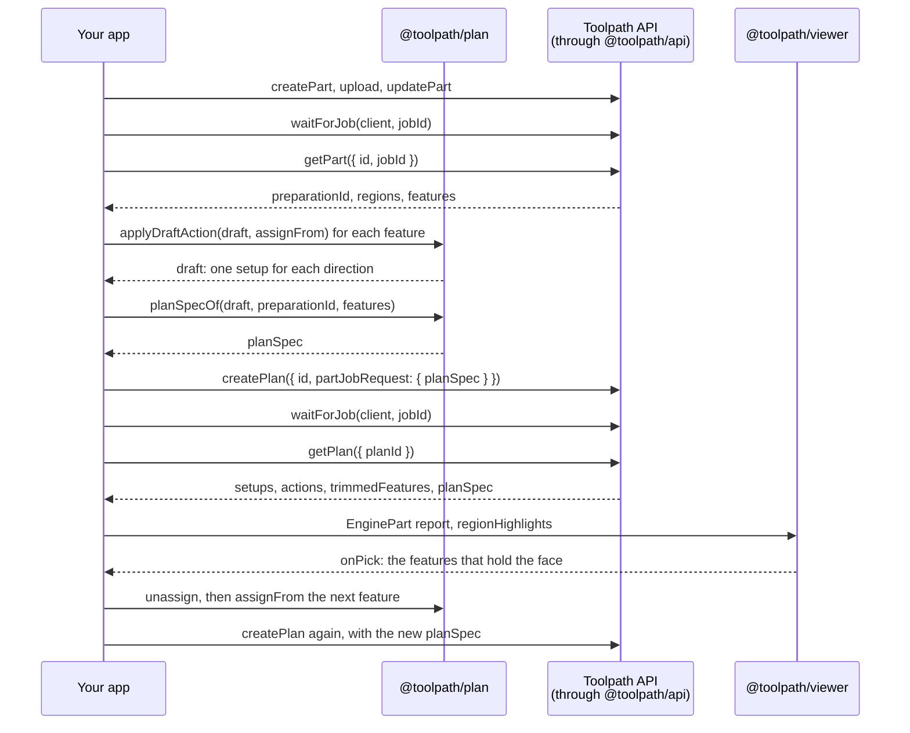

# Plan by region

The smallest app that plans a part face by face with
[`@toolpath/api`](https://www.npmjs.com/package/@toolpath/api),
[`@toolpath/plan`](https://www.npmjs.com/package/@toolpath/plan) and
[`@toolpath/viewer`](https://www.npmjs.com/package/@toolpath/viewer). It states which setup
machines each face as a **plan spec**, and Toolpath plans the part as it says.

Plan specs are **experimental**: `planSpec` and the plan routes may change in a minor API release.
Read the release notes before upgrading.

## Run it

```bash
pnpm install --frozen-lockfile
cp plan-spec/.env.example plan-spec/.env   # then set your API key
pnpm --filter @toolpath/example-plan-spec build
pnpm --filter @toolpath/example-plan-spec exec vite preview
```

Open the URL Vite prints and choose a STEP file of one part. Each face is painted in the colour of
the setup that machines it. Click a face to machine it as the next feature that holds it, then
**Plan again**.

`pnpm --filter @toolpath/example-plan-spec dev` needs a `@toolpath/viewer` release with the fix
for `EnginePart` under React's `StrictMode`: with 3.14.0, a development build draws a blank part.

## Read it

| File                                   | What it does                                                         |
| -------------------------------------- | -------------------------------------------------------------------- |
| [`src/plan-part.ts`](src/plan-part.ts) | Every API call, in order: analyze the part, then plan it.            |
| [`src/draft.ts`](src/draft.ts)         | The draft and its plan spec, with `@toolpath/plan`. No API calls.    |
| [`src/main.tsx`](src/main.tsx)         | The page: `<EnginePart>` painted by setup, and a click to re-assign. |
| [`vite.config.ts`](vite.config.ts)     | Forwards `/v1` to the API, so any key works from `localhost`.        |

## How it works

Four words matter here:

- A **region** is one face of the part, named by its index in the part's report.
- A **feature** is regions read as one thing to machine from one direction: a pocket from the top,
  a wall from the side. A region can be in several features, one for each way it can be reached.
- A **setup** is one way the part is held, facing one direction.
- A **draft** is what you ask for: setups, and the features each one machines. `@toolpath/plan`
  edits it and turns it into the plan spec Toolpath reads.



### Analyze and plan

In [`src/plan-part.ts`](src/plan-part.ts), with the same step numbers as its comments.

| Step       | SDK call                                                 | HTTP request                | What you get back                                     |
| ---------- | -------------------------------------------------------- | --------------------------- | ----------------------------------------------------- |
| 1. Upload  | `parts.createPart({ filename })`                         | `POST /v1/parts`            | `partId`, and a short-lived `uploadUrl`               |
|            | `uploadToPresignedUrl(uploadUrl, file)`                  | `PUT` to `uploadUrl`        | Nothing: the bytes go straight to storage             |
| 2. Analyze | `parts.updatePart({ id })`                               | `PATCH /v1/parts/{id}`      | A `jobId` for the analysis                            |
|            | `waitForJob(client, jobId)`                              | `GET /v1/jobs/{id}/events`  | The finished job, or a `JobFailedError`               |
|            | `parts.getPart({ id, jobId })`                           | `GET /v1/parts/{id}`        | `preparationId`, `regions`, `features`, mesh URLs     |
| 3. Plan    | `plans.createPlan({ id, partJobRequest: { planSpec } })` | `POST /v1/parts/{id}/plans` | A `planId` and its `jobId`                            |
| 4. Read it | `waitForJob(client, jobId)`                              | `GET /v1/jobs/{id}/events`  | The finished job, or a `JobFailedError`               |
|            | `plans.getPlan({ planId })`                              | `GET /v1/plans/{planId}`    | Setups and their actions, `trimmedFeatures`, the spec |

A spec the kernel cannot honor fails the plan's job, and its error begins `refused_plan_spec:`,
with one clause for each statement refused.

### Draft and plan spec

In [`src/draft.ts`](src/draft.ts), with the same step numbers as its comments.

| Step             | Plan call                                         | What it does                                                                                                       |
| ---------------- | ------------------------------------------------- | ------------------------------------------------------------------------------------------------------------------ |
| 1. First draft   | `applyDraftAction(draft, { kind: 'assignFrom' })` | Each face goes to the first feature the report lists that holds it, in a setup facing that feature's direction.    |
| 2. A click       | `unassign`, then `assignFrom`                     | The face goes to the next feature that holds it, and the feature it was in is let go.                              |
| 3. The plan spec | `planSpecOf(draft, preparationId, features)`      | The draft by region: each setup's direction and features. Refused here if it names more regions than a plan takes. |

`PlanRules` tells the package each feature's regions and the analysis that numbered them
(`preparationId`): a spec's regions only mean something under that analysis.

### Good to know

- **No setups added.** On a part with a `preparationId`, the draft's first setup sets
  `additionalDirections: []`, so Toolpath plans only the setups the spec states. A setup left with
  no features is dropped, and nothing replaces it. Set `additionalDirections` to `null` with the
  `setAdditionalDirections` action to let Toolpath add setups.
- **The `PlanSpec` cast.** `planSpecOf` gives each feature's `featureType` as the report's string,
  and the SDK types it as an enum, so `specOf` returns `spec as PlanSpec`.
- **Saved drafts.** This draft only assigns the report's own features, so `planSpecOf`'s `unstated`
  is always empty. An app that stores drafts must check it, and `staleCustomOf` for features drawn
  from regions, before sending: a part analyzed again may number its regions differently.
- **The completed spec.** `getPlan` returns the plan's own `planSpec`, with every choice it made
  written out. Send it back, edited, to plan the part again.

## Before you ship something like this

- **Keep your key on a server.** This example puts it in the browser to stay short, and `vite build`
  writes it into the bundle. Anyone who can load the page can read it.
- **Plan on request.** Each **Plan again** queues a new plan. Batch a person's edits before asking.
