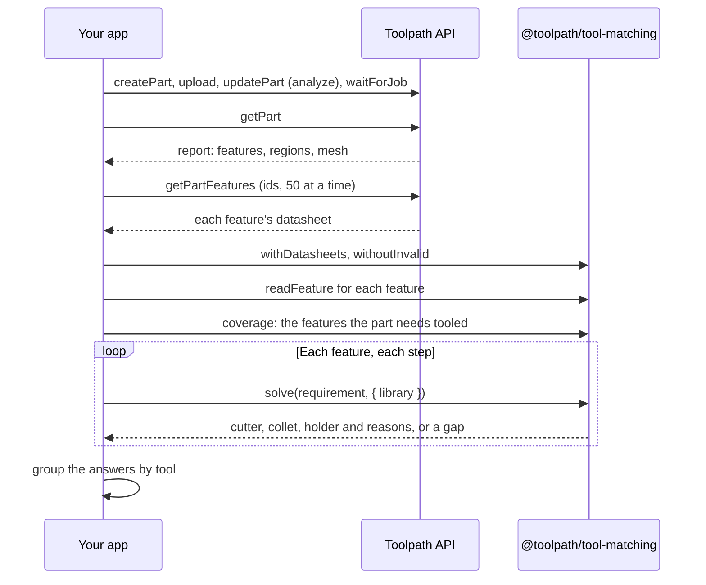

# Tool matching

A small app that shows which tools in a tool library make a part, and how each one is used, with
[`@toolpath/tool-matching`](https://www.npmjs.com/package/@toolpath/tool-matching). It draws the
part with [`@toolpath/viewer`](https://www.npmjs.com/package/@toolpath/viewer), each feature in
the colour of the tool that makes it.

## Run it

```bash
pnpm install --frozen-lockfile
pnpm --filter @toolpath/example-tool-matching dev
```

Open the URL Vite prints and click a sample part. The samples are saved API responses, so they
need no API key and cost nothing.

To analyze your own part, copy `tool-matching/.env.example` to `tool-matching/.env`, set
`VITE_TOOLPATH_API_KEY`, and restart the dev server. A file picker then appears under the samples.
**Each upload is one billed analysis.**

On the page:

- Each card is one tool from the library, tinted the colour it is drawn in on the part. Under its
  spec, one row per way the part uses it: the step (drill, helical mill, mill, finish, chamfer,
  tap), the features it makes, and the stick-out. Hover the ⓘ for why matching chose it.
- Point at a card to see the features that tool makes; click it, or click the part, to keep them
  shown.
- **Not in this library** lists the features nothing in the library makes; hover the ⓘ for why.
- **Tool library** lists everything matching may choose from. Switch between mm and in at the
  bottom left.

The page is built with [`@toolpath/ui`](https://www.npmjs.com/package/@toolpath/ui) (cards, badges,
tooltips, the units toggle) on Tailwind CSS v4, with [Phosphor](https://phosphoricons.com) icons
and the Toolpath app's own tool icons in [`src/icons.tsx`](src/icons.tsx).

## Read it

| File                                         | What it does                                                                              |
| -------------------------------------------- | ----------------------------------------------------------------------------------------- |
| [`src/match-part.ts`](src/match-part.ts)     | The matching itself: a part report and a library in, the tools and how each is used out.  |
| [`src/library.ts`](src/library.ts)           | The tool library: a made-up shop's cutters, holders and collets, as tool-support records. |
| [`src/analyze-part.ts`](src/analyze-part.ts) | Every API call matching needs, from a CAD file to the report and its datasheets.          |
| [`src/part-report.ts`](src/part-report.ts)   | Two API responses into the report matching reads.                                         |
| [`src/main.tsx`](src/main.tsx)               | The page: samples, upload, the viewer and the tool list.                                  |
| [`src/tool-card.tsx`](src/tool-card.tsx)     | One tool and its uses, in the package's own words.                                        |
| [`src/icons.tsx`](src/icons.tsx)             | The Toolpath app's drill, end mill and chamfer mill icons, and a tap drawn to match.      |
| [`scripts/analyze-samples.ts`](scripts/)     | Makes the samples in `public/parts/`.                                                     |

## How it works



### 1. A report matching can read

Matching reads a part's features and each one's **datasheet**. The report (`GET /v1/parts/{id}`)
leaves the datasheets out, so read them with `GET /v1/parts/{id}/features` and put them back with
`withDatasheets`. `withoutInvalid` then drops features the analysis found can't be cut. See
[`src/part-report.ts`](src/part-report.ts).

The samples are those same two responses, saved by
[`scripts/analyze-samples.ts`](scripts/analyze-samples.ts), so a sample and an upload go through
the same code.

### 2. A tool library

A library is tool-support's `ToolLibrary`: `tools`, `holders` and `collets`, every length in
millimetres. [`src/library.ts`](src/library.ts) builds a made-up one with small helpers, the way
you would map your own source (a vendor catalog, a crib export) into the same records. Matching
offers nothing outside it.

`prepareLibrary` runs `matchable`, which keeps the cutters matching knows (solid drills, spot
drills, taps, end mills, chamfer mills), and `withReach`, which works out how far each can reach.
Do it once, not for every part.

### 3. From features to tools

All in [`src/match-part.ts`](src/match-part.ts):

| Step                 | Call                                                  | What it does                                                                                                                                    |
| -------------------- | ----------------------------------------------------- | ----------------------------------------------------------------------------------------------------------------------------------------------- |
| Read each feature    | `readFeature(feature, report.directionZBounds)`       | What the feature asks of a drill, a tap or a mill.                                                                                              |
| Keep what needs tool | `coverage(features, readings, {}, hasTools)`          | The Engine reads one face as several features, and a through hole from both ends. Keeps one of each, preferring ones the library has tools for. |
| Choose the steps     | `drillRequirement`, `millRequirement`, `approachRank` | A tapped hole is drilled, then tapped; a plain hole drilled or helically milled, whichever ranks first; anything else milled.                   |
| Solve each step      | `solve(requirement, { library, limit: 1 })`           | The best assembly (cutter, collet, holder) and why, or a `gap` saying why nothing fits.                                                         |
| Stick-out            | `stickoutIn(assembly, requirement, library.collets)`  | How far the cutter stands out of its holder for this feature.                                                                                   |

The page groups the answers by cutter. Matching returns data, not sentences: the page writes it
with the package's `@toolpath/tool-matching/text` (`describe`, `featureName`, `countedName`,
`gapText`) and its own [`src/words.ts`](src/words.ts) for the step names and reasons.

### Good to know

- **Cost.** Opening a sample makes no API calls. An upload makes one billed analysis; reading the
  report, its datasheets and the mesh is free.
- **One part per file.** An upload is analyzed as one part. For a file of several bodies, see
  [`multi-body/`](../multi-body/).
- **Defaults only.** This example asks matching for its first choice with no filters. Matching
  also takes the visitor's filters, holder picks and locks (`SolveContext`), and lists every
  cutter that fits a feature (`listTools`); see the package's README.
- **Refreshing the samples.**
  `TOOLPATH_API_KEY=... pnpm --filter @toolpath/example-tool-matching analyze-samples -- part.step`
  analyzes a STEP file and saves it to `public/parts/`. It is billed like an upload.

## Before you ship something like this

- **Keep your key on a server.** This example puts it in the browser to stay short, and
  `vite build` writes it into the bundle. Anyone who can load the page can read it.
- **Solve off the main thread for big parts.** Matching is plain TypeScript and fast for these
  parts, but a part of hundreds of features against a large library is better solved in a worker.
